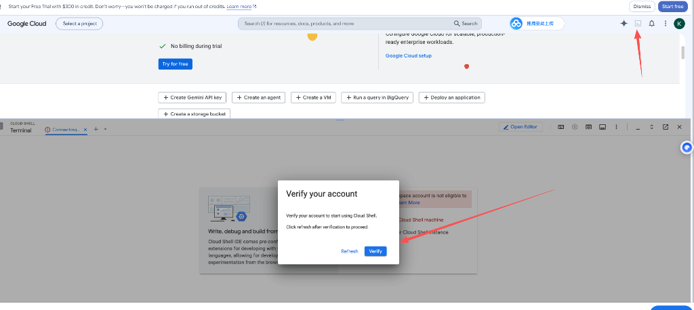
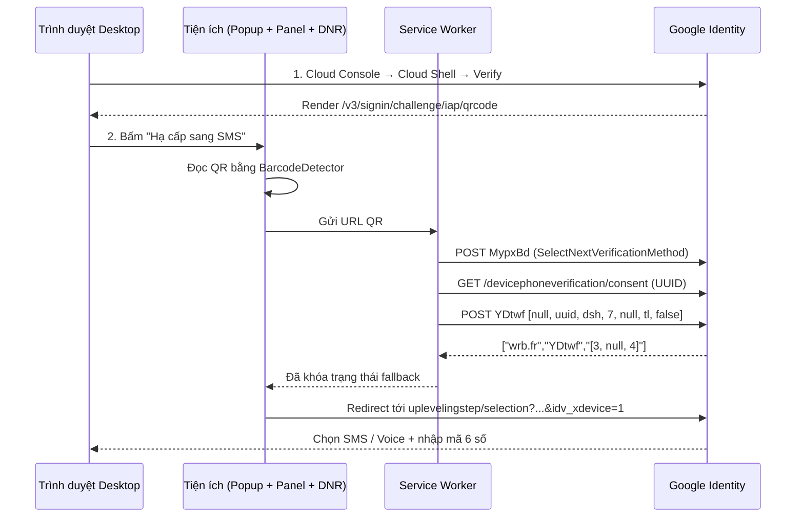

# Google QR Extractor · by Thog

<p align="center">
  
  
  
  
</p>

<p align="center">
  <b>Chuyển bước xác minh QR bắt buộc của Google về lại luồng nhập số điện thoại nhận mã SMS 6 số quen thuộc.</b><br/>
  Giao diện Thog, có dark / light và 3 ngôn ngữ: English · Tiếng Việt · 中文.
</p>

<p align="center">
  <a href="./README.md">English</a> · <a href="./README-ZH.md">中文说明</a>
</p>

---

## ✨ Có gì mới

- **Giao diện Thog** — đồng bộ với các extractor khác của Thog: dark / light, font Syne + DM Sans + DM Mono, gradient accent, status phát sáng.
- **3 ngôn ngữ** — English, Tiếng Việt, 中文. Đổi ngay trong popup và được lưu lại.
- **Popup + panel nổi trên trang** — thao tác từ icon trên thanh công cụ hoặc từ panel ở góc phải dưới.
- **Trạng thái rõ ràng** — popup nhận biết bạn đang ở Cloud Console, trang QR hay trang không hỗ trợ, và hướng dẫn bước tiếp theo.
- **Tên file dễ nhớ** — `service-worker.js`, `qr-panel.js`, `ipad-spoof.js`, `popup.html`, `popup.css`, `popup.js`.
- Logic hạ cấp gốc (đọc QR → inject `[3,null,4]` → header iPad Mini) được giữ nguyên.

---

## 📦 Cài đặt

1. Tải hoặc clone repo này.
2. Mở `chrome://extensions/` trên Chrome / Edge / Brave.
3. Bật **Developer mode** (góc trên bên phải).
4. Bấm **Load unpacked** và chọn thư mục **`thog`** bên trong repo.

> Tiện ích nằm trong `thog/`. README và LICENSE ở thư mục gốc.

---

## 🚀 Cách sử dụng

> [!IMPORTANT]
> Luôn bắt đầu từ **Google Cloud Console → Cloud Shell → Verify**. Trang QR mở từ ứng dụng bên thứ ba (Antigravity, Gemini Code Assist…) có thể chứa redirect lồng nhau và bị Google đẩy ngược về trang QR.

### 1. Mở Cloud Console

Đăng nhập **https://console.cloud.google.com/** bằng tài khoản cần xác minh.

### 2. Mở Cloud Shell và bấm Verify

Bấm icon tiện ích → **Tự mở Cloud Shell**, hoặc bấm icon terminal `[>_]` ở góc trên bên phải trang.

Sau đó bấm nút **Verify** màu xanh ở bảng phía dưới:



### 3. Hạ cấp trang QR

Trang xác minh QR mở ra. Chờ ảnh QR tải xong, rồi bấm **Hạ cấp sang SMS** trong popup (hoặc panel nổi).

Tiện ích sẽ:

1. đọc mã QR bằng `BarcodeDetector` gốc của trình duyệt;
2. gọi RPC `MypxBd` / `YDtwf` của Google để lấy `[3,null,4]` (trạng thái fallback cho thiết bị không phải Android);
3. chuyển tab sang hồ sơ **iPad Mini**;
4. redirect tới `uplevelingstep/selection?...&idv_xdevice=1`.

### 4. Xác minh bằng điện thoại

Chọn **Text message (SMS)** (hoặc cuộc gọi thoại), nhập số điện thoại và gửi mã 6 số `G-xxxxxx`.

Sau khi xong, quay lại Cloud Shell / Antigravity / Gemini CLI và refresh — tài khoản đã được mở khóa.

---

## ❓ Câu hỏi thường gặp

### Vì sao hạ cấp xong lại quay về trang QR?

Chỉ trang QR mở từ **Cloud Shell → Verify** mới có tham số `continue` sạch trỏ tới `accounts.google.com/uplevelingstep/selection?...`. Trang QR của bên thứ ba thường bọc thêm redirect nên Google đẩy bạn về lại trang QR. Hãy bắt đầu từ Cloud Shell.

### Vì sao giả lập iPad Mini mà không phải iPad Pro / desktop?

Endpoint `uplevelingstep/selection` của Google kiểm tra `User-Agent`:

- Desktop Windows / macOS và profile "iPad Pro 13" trong DevTools vẫn gửi `Macintosh; Intel Mac OS X`, nên Google bỏ qua `idv_xdevice=1` và quay lại trang QR.
- iPad Mini gửi UA mobile thuần (`iPad; CPU OS 16_6 ... Mobile/15E148`), và UA này phải giữ nguyên trên request `/_/IdvUplevelingUi/data/batchexecute` khi gửi mã.

Bản 1.2.0 phủ toàn bộ đường dẫn bằng `declarativeNetRequest`, không cần bật device mode trong DevTools.

### Báo "Không thấy mã QR" thì làm sao?

Chờ ảnh QR đen hiển thị đầy đủ rồi thử lại. Dùng Chrome / Edge 88+ (có hỗ trợ `BarcodeDetector` gốc).

---

## 🧠 Nguyên lý hoạt động



---

## 📁 Cấu trúc dự án

```text
Google-Qr-extractor/
├── README.md                  # Tài liệu tiếng Anh
├── README-VN.md               # Tài liệu tiếng Việt
├── README-ZH.md               # Tài liệu tiếng Trung
├── LICENSE                    # MIT
└── thog/                      # ← chọn thư mục này khi Load unpacked
    ├── manifest.json          # Manifest V3
    ├── popup.html             # Giao diện popup Thog
    ├── popup.css              # Theme dark / light
    ├── popup.js               # i18n EN / VI / 中文 + logic popup
    ├── service-worker.js      # DNR header iPad Mini + RPC [3,null,4]
    ├── qr-panel.js            # Panel nổi + đọc QR + redirect
    ├── ipad-spoof.js          # Đồng bộ navigator ở main world
    ├── assets/
    │   └── cloud-shell-verify.png
    └── icons/
        ├── 16.png
        ├── 48.png
        └── 128.png
```

---

## 📨 Contact

Connect with us for support or updates:

- **Telegram**: [thog099](https://t.me/thog099)
- **Channel**: [CHANNEL](https://t.me/thogairdrops)
- **Group**: [GROUP CHAT](https://t.me/thogchats)
- **X**: [Thog](https://x.com/thog099)

---

## ☕ Support Us

Love these tools? Fuel our work with a coffee!

🔗 BUYMECAFE: [BUY ME CAFE](https://buymecafe.vercel.app/)

🔗 WEBSITE: [BUY SCRIPTS](https://thogtoolhub.com/)

-------
