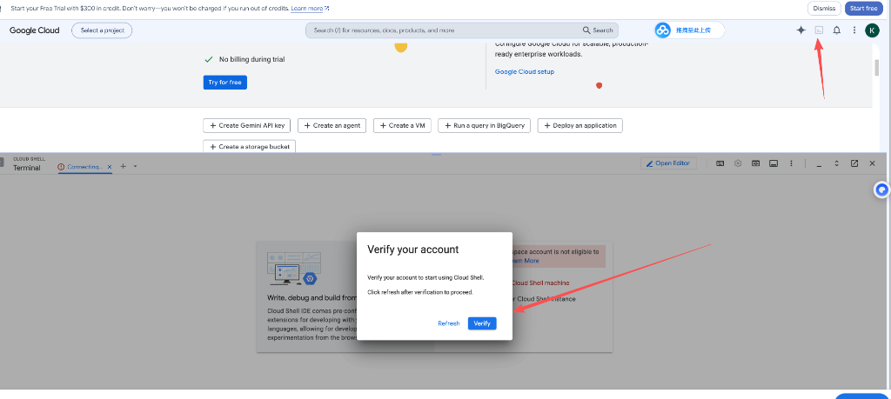
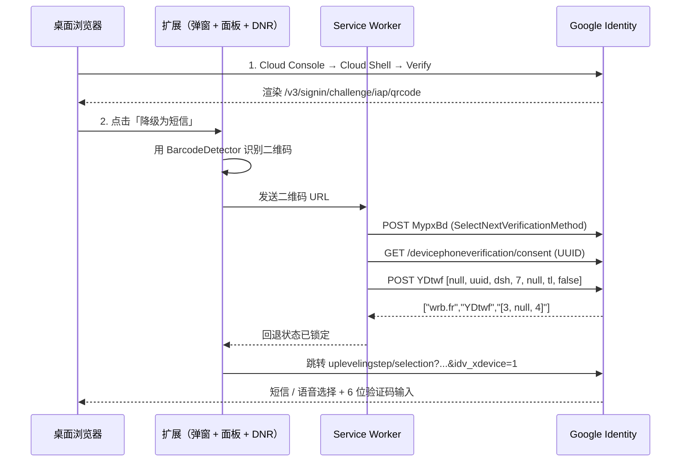

# Google QR Extractor · by Thog

<p align="center">
  
  
  
  
</p>

<p align="center">
  <b>把 Google 强制跨设备扫码验证，一键降级回传统的「输入手机号接收 6 位短信验证码」流程。</b><br/>
  Thog 风格界面，支持深色 / 浅色主题与 English · Tiếng Việt · 中文。
</p>

<p align="center">
  <a href="./README.md">English</a> · <a href="./README-VN.md">Tiếng Việt</a>
</p>

---

## ✨ 本次更新

- **Thog 界面** — 与其它 Thog extractor 保持一致的视觉：深色 / 浅色、Syne + DM Sans + DM Mono 字体、渐变强调色、发光状态点。
- **三语言** — English、Tiếng Việt、中文，可在弹窗内切换并自动保存。
- **弹窗 + 页面悬浮面板** — 既可以从工具栏弹窗操作，也可以使用页面右下角的悬浮面板。
- **状态更清晰** — 弹窗会识别 Cloud Console、二维码页或不支持的页面，并提示下一步操作。
- **文件名更易记** — `service-worker.js`、`qr-panel.js`、`ipad-spoof.js`、`popup.html`、`popup.css`、`popup.js`。
- 核心降级逻辑（识别二维码 → 注入 `[3,null,4]` → iPad Mini 请求头）保持不变。

---

## 📦 安装

1. 下载或 clone 本仓库。
2. 在 Chrome / Edge / Brave 打开 `chrome://extensions/`。
3. 打开右上角 **开发者模式 (Developer mode)**。
4. 点击 **加载已解压的扩展程序 (Load unpacked)**，选择仓库内的 **`thog`** 文件夹。

> 扩展本体位于 `thog/`，README 与 LICENSE 位于仓库根目录。

---

## 🚀 使用步骤

> [!IMPORTANT]
> 请始终从 **Google Cloud Console → Cloud Shell → Verify** 进入。第三方应用（Antigravity、Gemini Code Assist 等）弹出的二维码页可能包含多层跳转，会被 Google 重新拦截回二维码。

### 1. 打开 Cloud Console

使用要验证的账号登录 **https://console.cloud.google.com/**。

### 2. 启动 Cloud Shell 并点击 Verify

点击扩展图标 → **自动打开 Cloud Shell**，或点击页面右上角的终端图标 `[>_]`。

然后在底部面板点击蓝色 **Verify** 按钮：



### 3. 降级二维码页

进入二维码验证页后，等二维码图片加载完成，点击弹窗（或悬浮面板）中的 **降级为短信**。

扩展会：

1. 用浏览器原生 `BarcodeDetector` 识别二维码；
2. 调用 Google 的 `MypxBd` / `YDtwf` RPC，取得 `[3,null,4]`（非 Android 设备的回退状态）；
3. 把当前标签页切换为 **iPad Mini** 环境；
4. 跳转到 `uplevelingstep/selection?...&idv_xdevice=1`。

### 4. 用手机完成验证

选择 **Text message (SMS)**（或语音通话），输入手机号，提交 6 位 `G-xxxxxx` 验证码。

完成后回到 Cloud Shell / Antigravity / Gemini CLI 刷新即可正常使用。

---

## ❓ 常见问题

### 为什么降级后又跳回二维码？

只有从 **Cloud Shell → Verify** 打开的二维码页，其 `continue` 参数才指向干净的 `accounts.google.com/uplevelingstep/selection?...`。第三方 OAuth 二维码页通常包了额外跳转，Google 会把你送回二维码页。请从 Cloud Shell 开始。

### 为什么伪装 iPad Mini，而不是 iPad Pro / 桌面？

Google 的 `uplevelingstep/selection` 会校验 `User-Agent`：

- Windows / macOS 桌面以及 DevTools 里的 “iPad Pro 13” 仍然发送 `Macintosh; Intel Mac OS X`，Google 会忽略 `idv_xdevice=1` 并跳回二维码。
- iPad Mini 发送纯移动端 UA（`iPad; CPU OS 16_6 ... Mobile/15E148`），并且在提交验证码的 `/_/IdvUplevelingUi/data/batchexecute` 请求上必须保持同一个 UA。

1.2.0 版通过 `declarativeNetRequest` 覆盖全路径，无需手动开 DevTools 设备模式。

### 提示“未识别到二维码”怎么办？

等黑色二维码图案完全显示后再点一次。请使用 Chrome / Edge 88+（支持原生 `BarcodeDetector`）。

---

## 🧠 工作原理



---

## 📁 项目结构

```text
Google-Qr-extractor/
├── README.md                  # 英文说明
├── README-VN.md               # 越南语说明
├── README-ZH.md               # 中文说明
├── LICENSE                    # MIT
└── thog/                      # ← 加载这个文件夹作为扩展
    ├── manifest.json          # Manifest V3
    ├── popup.html             # Thog 弹窗结构
    ├── popup.css              # 深色 / 浅色主题
    ├── popup.js               # EN / VI / 中文 i18n + 弹窗逻辑
    ├── service-worker.js      # DNR iPad Mini 请求头 + [3,null,4] RPC
    ├── qr-panel.js            # 页面悬浮面板 + 二维码识别 + 跳转
    ├── ipad-spoof.js          # Main world navigator 对齐
    ├── assets/
    │   └── cloud-shell-verify.png
    └── icons/
        ├── 16.png
        ├── 48.png
        └── 128.png
```

---

## 📨 Contact

Connect with us for support or updates:

- **Telegram**: [thog099](https://t.me/thog099)
- **Channel**: [CHANNEL](https://t.me/thogairdrops)
- **Group**: [GROUP CHAT](https://t.me/thogchats)
- **X**: [Thog](https://x.com/thog099)

---

## ☕ Support Us

Love these tools? Fuel our work with a coffee!

🔗 BUYMECAFE: [BUY ME CAFE](https://buymecafe.vercel.app/)

🔗 WEBSITE: [BUY SCRIPTS](https://thogtoolhub.com/)

-------
