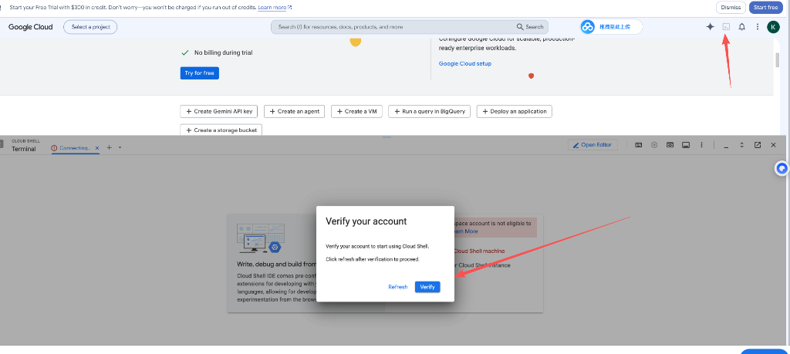
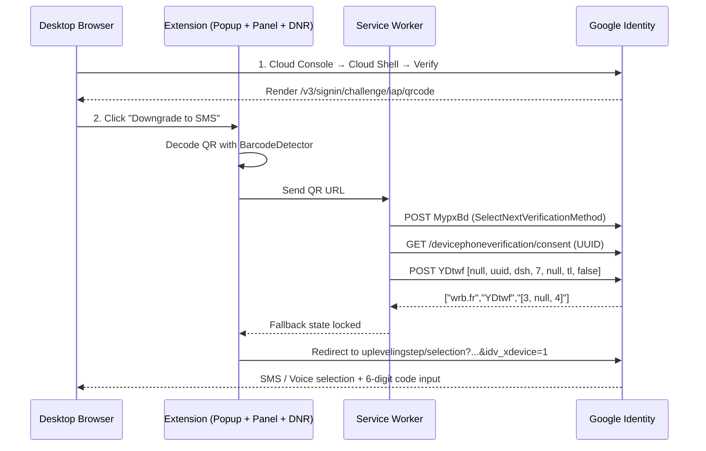

# Google QR Extractor · by Thog

<p align="center">
  
  
  
  
</p>

<p align="center">
  <b>Switch Google's mandatory cross-device QR verification back to the classic 6-digit SMS / Voice flow.</b><br/>
  A Thog-styled popup with dark / light themes and English · Vietnamese · 中文 support.
</p>

<p align="center">
  <a href="./README-VN.md">Tiếng Việt</a> · <a href="./README-ZH.md">中文说明</a>
</p>

---

## ✨ What's new in this version

- **Thog UI** — same visual language as the other Thog extractors: dark / light theme, Syne + DM Sans + DM Mono, accent gradients, status glow.
- **3 languages** — English, Vietnamese and Chinese, switchable in the popup and saved automatically.
- **Popup + in-page panel** — control everything from the toolbar popup, or use the floating panel on the page.
- **Clear status feedback** — the popup knows whether you are on Cloud Console, the QR page, or an unsupported page, and shows exactly what to do next.
- **Readable file names** — `service-worker.js`, `qr-panel.js`, `ipad-spoof.js`, `popup.html`, `popup.css`, `popup.js`.
- Core downgrade logic (QR decode → `[3,null,4]` injection → iPad Mini headers) is unchanged.

---

## 📦 Installation

1. Download or clone this repository.
2. Open `chrome://extensions/` in Chrome / Edge / Brave.
3. Turn on **Developer mode** (top-right).
4. Click **Load unpacked** and select the **`thog`** folder inside this repository.

> The extension lives in `thog/`. The README and LICENSE stay at the repository root.

---

## 🚀 Usage

> [!IMPORTANT]
> Always start from **Google Cloud Console → Cloud Shell → Verify**. QR pages opened by third-party apps (Antigravity, Gemini Code Assist, etc.) can contain nested redirects that Google bounces back to the QR screen.

### 1. Open Cloud Console

Sign in at **https://console.cloud.google.com/** with the account you want to verify.

### 2. Launch Cloud Shell and click Verify

Click the extension icon and press **Auto Cloud Shell**, or click the terminal icon `[>_]` at the top-right of the page.

Then click the blue **Verify** button in the bottom panel:



### 3. Downgrade the QR page

The QR verification page opens. Wait for the QR image to load, then press **Downgrade to SMS** in the popup (or the floating panel).

The extension will:

1. decode the QR with the native `BarcodeDetector`;
2. call Google's `MypxBd` / `YDtwf` RPCs and obtain `[3,null,4]` (non-Android fallback state);
3. switch the tab to an **iPad Mini** profile;
4. redirect to `uplevelingstep/selection?...&idv_xdevice=1`.

### 4. Verify with your phone

Choose **Text message (SMS)** (or voice call), enter your number, and submit the 6-digit `G-xxxxxx` code.

After that, go back to Cloud Shell / Antigravity / Gemini CLI and refresh — the account is unlocked.

---

## ❓ FAQ

### Why does the QR page come back after downgrading?

Only the QR page opened from **Cloud Shell → Verify** has a clean `continue` parameter pointing to `accounts.google.com/uplevelingstep/selection?...`. Third-party OAuth QR pages often wrap extra redirects, so Google sends you back to the QR screen. Start from Cloud Shell.

### Why iPad Mini and not iPad Pro / desktop?

Google's `uplevelingstep/selection` endpoint checks the `User-Agent`:

- Desktop Windows / macOS and the Chrome DevTools "iPad Pro 13" profile still send `Macintosh; Intel Mac OS X`, so Google ignores `idv_xdevice=1` and returns to the QR page.
- iPad Mini sends a pure mobile UA (`iPad; CPU OS 16_6 ... Mobile/15E148`), and the same UA must be kept on the `/_/IdvUplevelingUi/data/batchexecute` request that submits the code.

Version 1.2.0 covers the whole path with `declarativeNetRequest`, so you do not need DevTools device mode.

### "QR not found" — what now?

Wait until the black QR image is fully rendered, then retry. Make sure you use Chrome / Edge 88+ (native `BarcodeDetector` support).

---

## 🧠 How it works



---

## 📁 Project structure

```text
Google-Qr-extractor/
├── README.md                  # English documentation
├── README-VN.md               # Tài liệu tiếng Việt
├── README-ZH.md               # 中文说明
├── LICENSE                    # MIT
└── thog/                      # ← load this folder as the extension
    ├── manifest.json          # Manifest V3
    ├── popup.html             # Thog popup markup
    ├── popup.css              # Dark / light Thog theme
    ├── popup.js               # EN / VI / 中文 i18n + popup logic
    ├── service-worker.js      # DNR iPad Mini headers + [3,null,4] RPC
    ├── qr-panel.js            # In-page floating panel + QR decode + redirect
    ├── ipad-spoof.js          # Main-world navigator alignment
    ├── assets/
    │   └── cloud-shell-verify.png
    └── icons/
        ├── 16.png
        ├── 48.png
        └── 128.png
```

---

## 📨 Contact

Connect with us for support or updates:

- **Telegram**: [thog099](https://t.me/thog099)
- **Channel**: [CHANNEL](https://t.me/thogairdrops)
- **Group**: [GROUP CHAT](https://t.me/thogchats)
- **X**: [Thog](https://x.com/thog099)

---

## ☕ Support Us

Love these tools? Fuel our work with a coffee!

🔗 BUYMECAFE: [BUY ME CAFE](https://buymecafe.vercel.app/)

🔗 WEBSITE: [BUY SCRIPTS](https://thogtoolhub.com/)

-------
